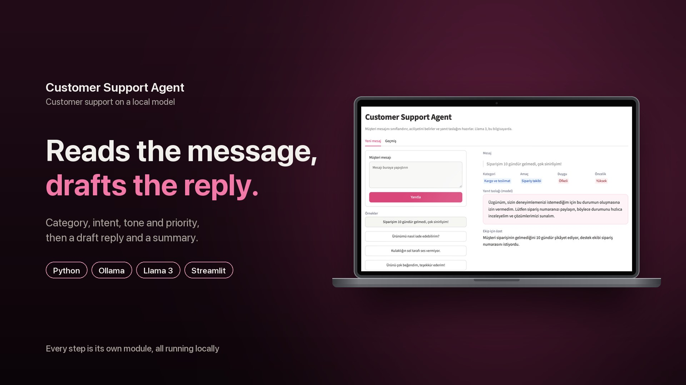
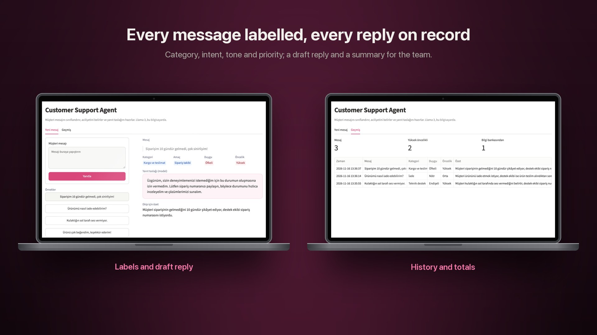
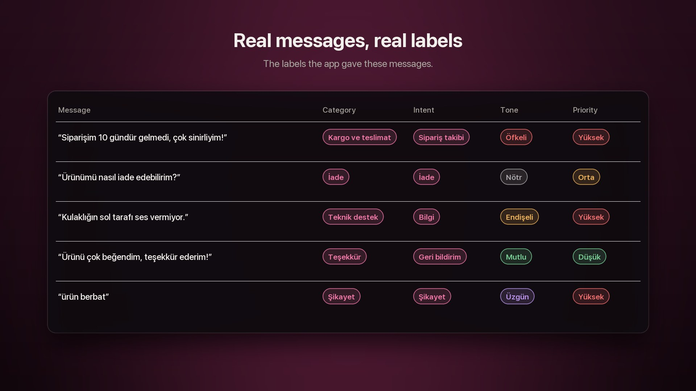
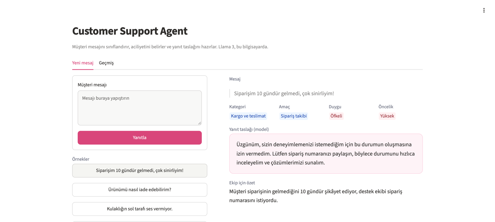
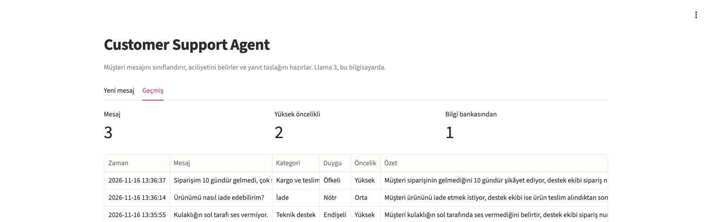
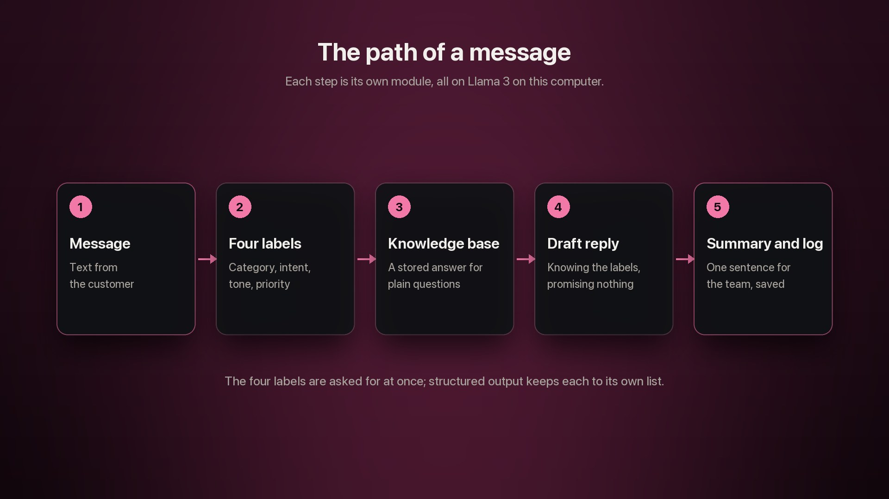
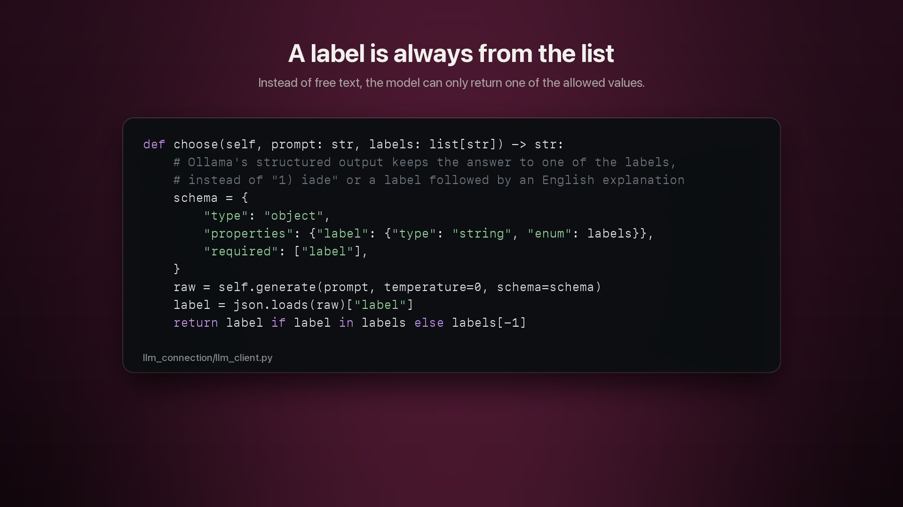

<p align="center">
  
</p>

Reads a customer message, works out what it is about and how urgent it is, and drafts a reply, all on a local model.

Python · Ollama (Llama 3) · Streamlit



Each message gets a category (return, technical support, product information, delivery, complaint, thanks), an intent, a tone and a priority. Plain questions such as *"Ürünümü nasıl iade edebilirim?"* are answered from a small knowledge base; everything else gets a reply drafted by the model in a tone that fits the labels, and a one-sentence summary for the support team.

## Screens





<details>
<summary>Full-size screenshots</summary>
<br/>


</details>

## How it works



Every step is a separate module that talks to Llama 3 through Ollama's local API. The four labels are asked for at the same time, and Ollama's structured output keeps each answer to the module's own list, so a label is always one of those words rather than "1) iade" or a word followed by an explanation.



The reply is asked not to promise refunds or dates it cannot know. Every message is saved, and the history tab lists them with how many were urgent and how many the knowledge base answered.

## Running it

You need Python 3.10 or newer and [Ollama](https://ollama.com).

```bash
ollama pull llama3

git clone https://github.com/omeraydin00/customer-support-agent.git
cd customer-support-agent/YapayZeka
python -m venv .venv && source .venv/bin/activate
pip install -r requirements.txt
streamlit run streamlit_app.py
```

Write a message in the page that opens, or pick one of the examples, and press **Yanıtla**. `SUPPORT_MODEL` picks another Ollama model and `OLLAMA_URL` another Ollama server.

## Structure

```
YapayZeka/
├── streamlit_app.py        the page and the order of the steps
├── llm_connection/         the Ollama client, with label-constrained answers
├── agent/nodes/            classification, intent, tone, priority,
│                           knowledge base, summary and logging
└── conversation_logs.json  created on the first message
```
